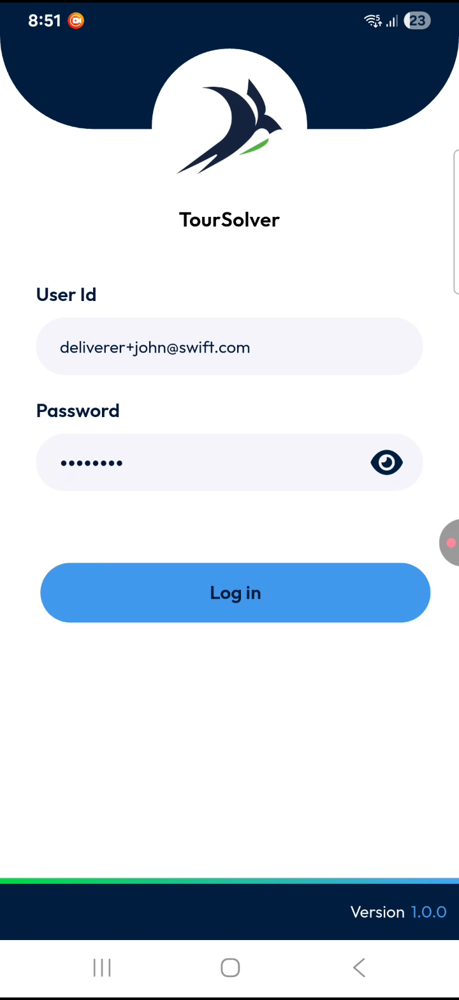

# Entrar

### Começando

Para garantir a melhor experiência com o aplicativo Nomadia TourSolver, verifique os requisitos de sistema do seu dispositivo.

* **Requisitos do Sistema** O aplicativo Nomadia TourSolver foi projetado para funcionar em vários dispositivos móveis. Para garantir a melhor experiência, verifique se o seu dispositivo atende aos seguintes requisitos:
  * **Android** os dispositivos devem estar executando **versão 8 a 14**.
  * **iOS** (Apple) os dispositivos precisam estar executando **versão 15.5 ou posterior**.
* **Etapas de Instalação e Configuração** Obter o aplicativo Nomadia TourSolver no seu dispositivo é rápido e fácil!
  1. **Baixar o Aplicativo**: Você pode baixar o aplicativo Nomadia TourSolver tanto na **App Store iOS** (para dispositivos Apple) ou na **Google Play Store** (para dispositivos Android).
  2. **Iniciar o Aplicativo**: Após o download, localize o **ícone do TourSolver** na tela principal do seu dispositivo e **toque nele** para abrir o aplicativo.

.png>)

* **Configuração Inicial: Visão Geral da Tela de Login** Quando você iniciar o aplicativo pela primeira vez, verá sempre a **tela de login**. Esta tela é onde você digitará suas informações para acessar o aplicativo. Ela inclui vários elementos-chave:
  * **Campo de ID de Usuário**: É aqui que você digitará sua identificação única de usuário.
  * **Campo de Senha**: É aqui que você digitará sua senha secreta.
  * **Botão Azul de Login**: Localizado no centro da tela, toque neste botão após inserir seus dados.
  * **Número da Versão do Aplicativo**: Você encontrará este número exibido no canto inferior direito da tela.

### Explicações de Recursos com Benefícios

* **Alternar Visibilidade da Senha (Ícone de Olho)** O **o campo de senha** possui um prático **ícone de olho**. Este recurso permite que você **alternar a visibilidade da sua senha digitada**. Isso significa que você pode ver temporariamente os caracteres que está digitando para garantir que não cometeu erros e depois escondê-los novamente por segurança.
  * 💡 **Dica**: Use o ícone de olho para verificar sua senha antes de tocar em **Entrar**, especialmente se estiver tendo problemas para fazer login!

### Tarefas Comuns com Etapas Detalhadas

* **Fazendo Login no Aplicativo** Seu **ID de usuário e senha** são definidos pelo seu **administrador do back office do TourSolver**. Se alguma vez você precisar **alterar sua senha**, por favor **contate seu administrador** diretamente. Aqui está como fazer login:
  1. **Digite Suas Informações**: Toque no **campo de ID de usuário** e digite seu ID de usuário. Em seguida, toque no **campo de senha** e digite sua senha.
  2. **Toque em Entrar**: Uma vez que ambos os campos estejam preenchidos, **toque no botão azul Entrar**.

3. **Login Bem-sucedido**: Se seu ID de usuário e senha estiverem corretos, você será **autenticado com sucesso e conectado ao aplicativo**.

* **Solução de Problemas: Login Incorreto** Às vezes, você pode digitar algo errado ou esquecer sua senha. Não se preocupe, o aplicativo irá avisá-lo!
  * Se o **nome de usuário ou senha que você inseriu estiver incorreto**, uma mensagem de erro dizendo "**Nome de usuário ou senha incorretos**" aparecerá. Esta mensagem será exibida entre o campo de senha e o botão de login.
  * ⚠️ **Aviso**: Se você vir essa mensagem, verifique novamente seu ID de usuário e senha quanto a erros de digitação e certifique-se de que o Caps Lock não esteja ativado acidentalmente.

### Dicas de Produtividade

* 💡 **Gerenciamento de Senhas**: Lembre-se sempre de que seu **administrador do back office do TourSolver** é o contato principal para quaisquer alterações ou problemas com a senha. Não hesite em contatá-los se estiver tendo problemas persistentes de login.
* 💡 **Verificação Rápida**: Use o **ícone de olho** ao lado do campo de senha para verificar rapidamente sua entrada de senha antes de tocar em **Entrar**. Isso pode economizar tempo se você tende a digitar errado.
