# Retirada

### 1. Começando

Para começar a usar o aplicativo TourSolver Mobile, siga estes passos.

#### Requisitos do Sistema e Instalação

Por favor, note que requisitos específicos **do sistema** e **etapas de instalação/configuração** para o aplicativo TourSolver Mobile não estão detalhados nas fontes fornecidas. Pode ser necessário consultar documentação adicional ou seu administrador de TI para obter essas informações.

#### Iniciando uma Intervenção

1. Uma vez que o aplicativo esteja instalado e você esteja pronto para começar seu trabalho, iniciar uma intervenção é simples:

2. Um **popup de confirmação** aparecerá.

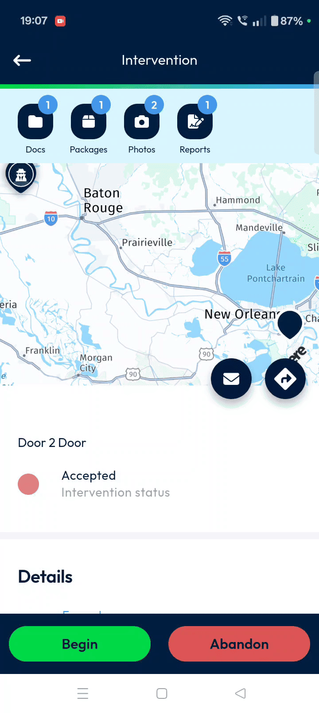

***

### 2. Principais Recursos e Benefícios

A interface do aplicativo TourSolver Mobile é projetada para navegação rápida e atualizações em tempo real.

**Espaço Reservado para Orientação Visual:**

* **Visão Geral da Tela Principal da Intervenção**: Esta ilustração mostraria a tela principal da intervenção, destacando a linha de ícones de navegação no topo, os ícones de acesso rápido e a seção de detalhes da intervenção. Isso forneceria uma visão útil da interface descrita abaixo.

#### Seções de Navegação (Ícones no Topo)

Logo abaixo dos ícones de navegação principais, você encontrará uma linha de ícones que permite alternar facilmente entre diferentes partes da sua intervenção. Cada ícone pode exibir um pequeno **selo azul** indicando o número de itens adicionados a essa seção, dando-lhe uma visão rápida do seu progresso.

* **Docs**: Aqui, você pode **enviar e visualizar documentos importantes** relacionados à sua intervenção. Isso mantém toda a papelada necessária organizada e acessível.
* **Pacotes**: Esta seção permite que você **gerencie o carregamento e descarregamento de pacotes**, crucial para tarefas de Coleta.
* **Fotos**: Facilmente **tire ou envie imagens** diretamente do campo, perfeito para capturar prova de entrega ou condições do local.
* **Observações**: Use esta área para **inserir quaisquer comentários ou notas** pertinentes à intervenção.
* **Relatórios**: É aqui que você pode **enviar o relatório oficial da intervenção**.
* **Assinatura**: Capture o **reconhecimento ou assinatura do cliente** diretamente no seu dispositivo.

<figure><figcaption></figcaption></figure>

#### Ferramentas de Acesso Rápido

Abaixo dos ícones de navegação principais, você verá o **selo do globo** e dois ícones de acesso rápido para ações imediatas.

* **Selo do Globo**: Este selo fornece uma visão rápida do seu **contexto geográfico atual**, mostrando exatamente onde a intervenção está localizada.
* **Ícone de Email**: Toque aqui para **enviar rapidamente atualizações ou contatar partes relevantes**.

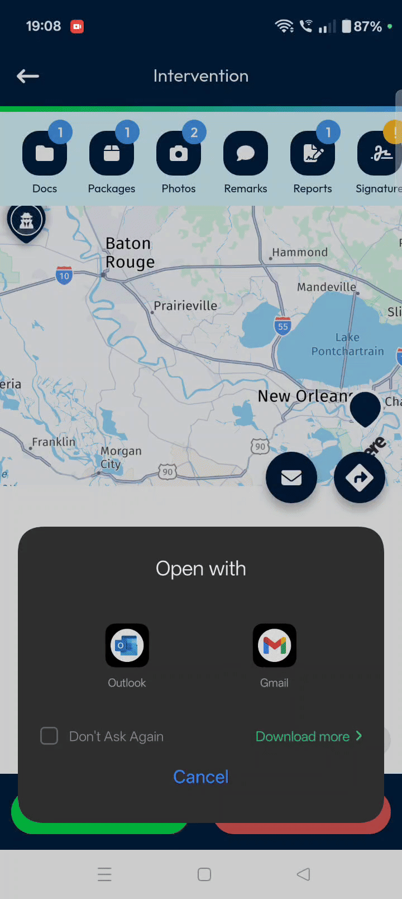

* **Botão de Navegação**: Localizado ao lado do ícone de email, tocar aqui abre seu **aplicativo de mapas preferido**, fornecendo orientação de rota instantânea até o local da intervenção.

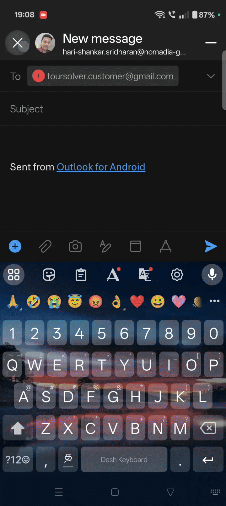

#### Detalhes da Intervenção

Abaixo desses ícones, você encontrará detalhes essenciais sobre sua intervenção atual:

* **Informações Chave**: Inclui o **título da intervenção**, seu **status**, **hora de início**, **hora de término**, e um **temporizador**.
* **Detalhes Adicionais**: Fornece informações mais específicas, como o **nome do local**, **endereço**, **título da intervenção**, **data e hora**, **horário anunciado de chegada**, **duração estimada**, **nomes dos participantes**, e **referência externa**.

***

### 3. Instruções Passo a Passo

Esta seção orienta você através das ações mais frequentes que realizará no aplicativo TourSolver Mobile.

#### Gerenciando Documentos (Seção Docs)

A seção Docs permite que você lide com toda a papelada necessária de forma digital.

1. Toque **Docs** para enviar documentos relevantes.
2. Para visualizar um documento, simplesmente toque nele para abrir.

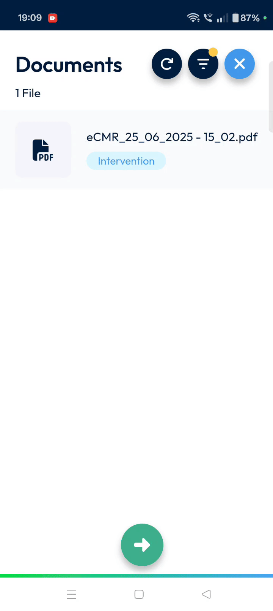

💡 **Dica**: Use o **ícone de filtro** no topo para classificar sua lista de documentos por intervenção ou local, ajudando você a encontrar documentos específicos mais rapidamente. Depois de selecionar seu filtro, lembre-se de tocar em **Aplicar**.

#### Digitalização e Gerenciamento de Pacotes (Seção Pacotes)

Isto é crucial para um gerenciamento preciso de Coleta.

<figure><figcaption></figcaption></figure>

<figure><figcaption></figcaption></figure>

1. Você verá informações como: **Clientes coletados data e hora**, **entregue ao cliente data e hora**, **nome do pedido**, e **nome e endereço do cliente**.
2. Você também pode inserir quaisquer **observações** na **caixa de comentários** fornecida.
3. Toque no botão Salvar na parte inferior para atualizar as alterações.

**Espaço Reservado para Orientação Visual:**

* **Digitalização e Detalhes do Pacote**]: Esta imagem poderia mostrar a interface de digitalização de pacotes com um círculo verde indicando uma digitalização bem-sucedida, e então uma visualização detalhada de um cartão de pacote com seus campos de informação. Isso esclarece o processo de digitalização e entrada de dados.

#### Capturando e Enviando Fotos (Seção Fotos)

Documente seu trabalho com imagens claras.

1. Toque no **scanner** para escanear o código QR

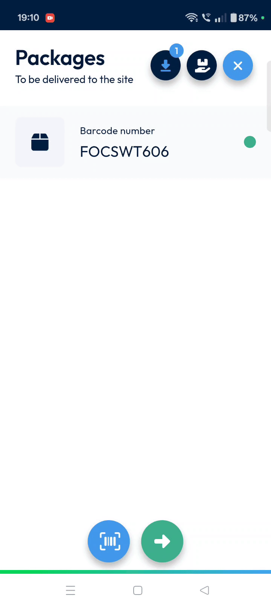

2. Uma vez escaneado, o número do código de barras aparecerá juntamente com um círculo verde ao lado dele."

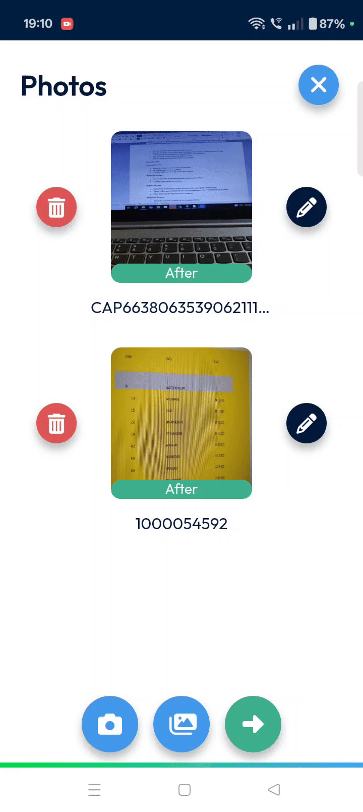

Toque no ícone de

#### Capturando e Enviando Fotos (Seção Fotos)

1. Documente seu trabalho com imagens claras.

2. Toque **Câmera** para tirar uma foto

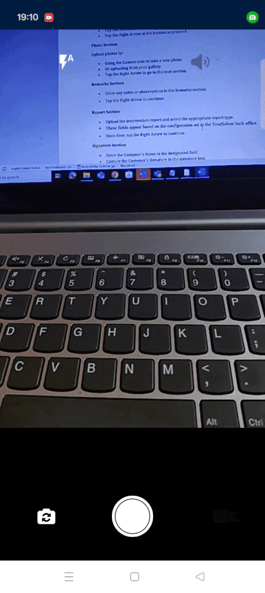

3. Selecione a **marca de seleção** para confirmar e enviar a foto."

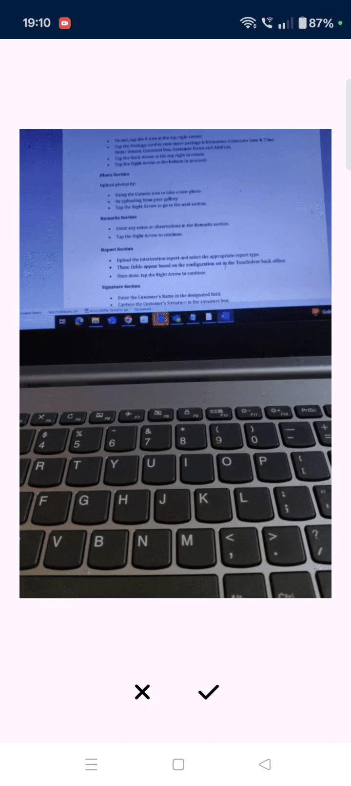

4. Toque **ícone de** foto para enviar uma imagem da galeria

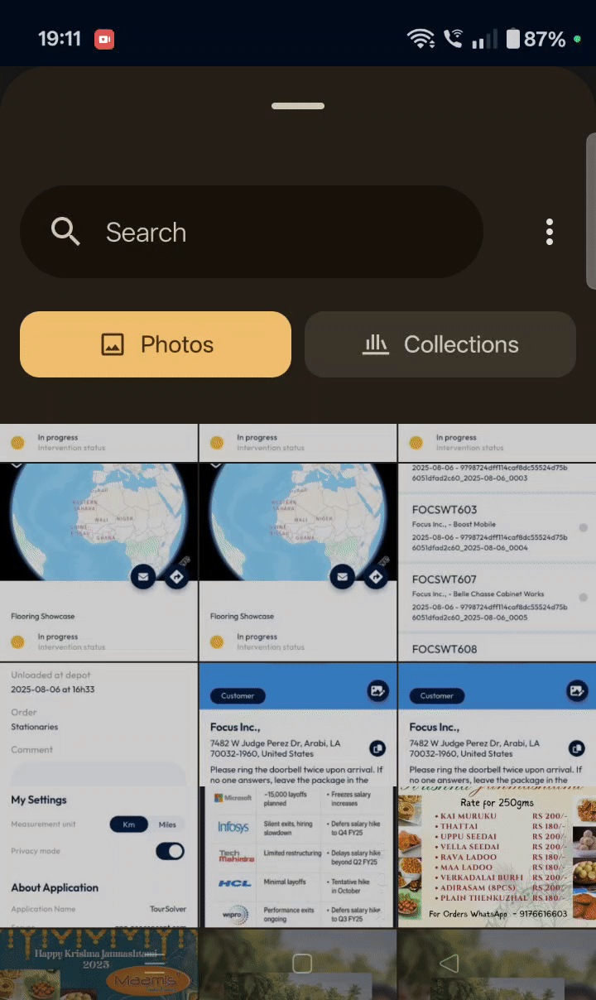

5. Toque **Salvar** para atualizar as alterações

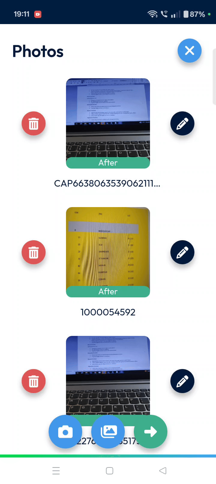

#### Adicionando Observações Gerais (Seção Observações)

Forneça contexto ou notas importantes para o back office.

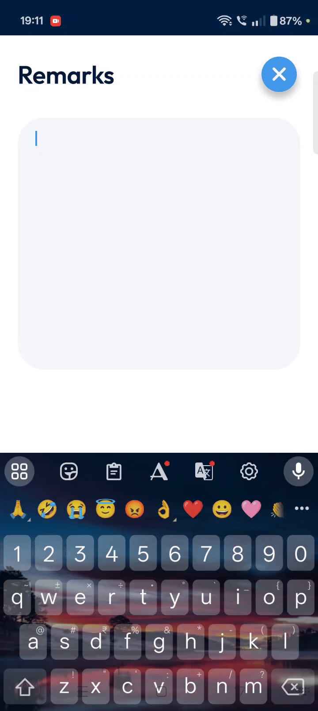

#### Enviando Relatórios de Intervenção (Seção Relatório)

Complete sua documentação oficial.

1. **Envie o relatório da intervenção.**

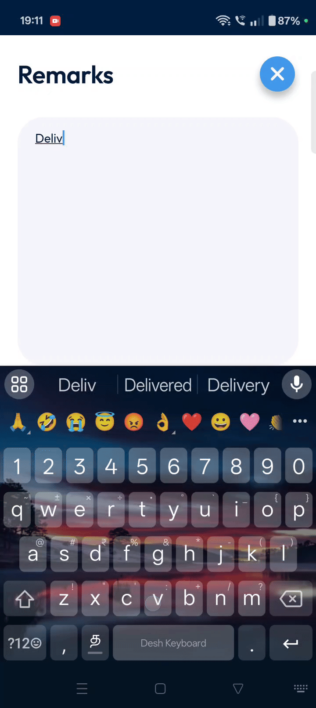

2. **Selecione o tipo de relatório apropriado**.

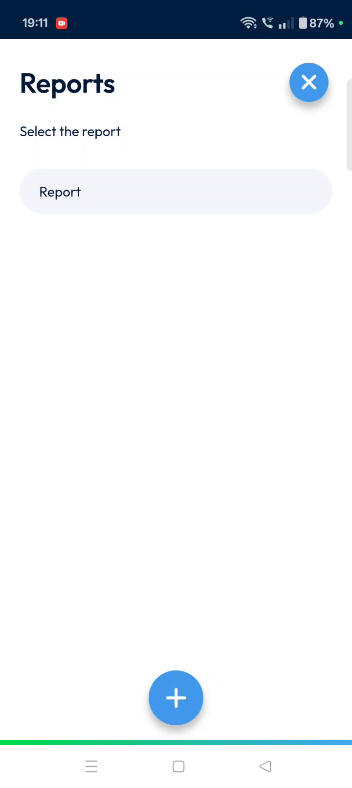

\
3\. **Preencha os detalhes necessários na opção de relatório relevante. Os campos exibidos aqui dependem da configuração definida no back office**

<figure>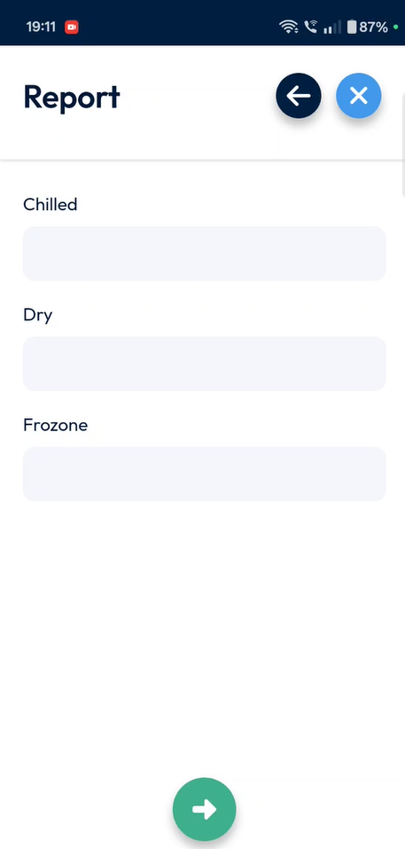<figcaption></figcaption></figure>

#### Captura de Assinaturas de Clientes (Seção Assinatura)

Registre o reconhecimento do cliente de forma segura e fácil.

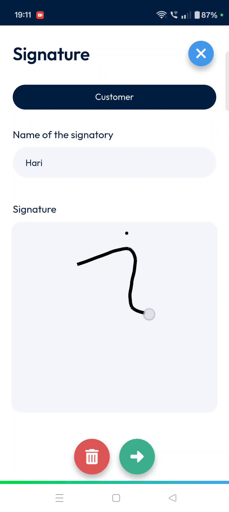

**Espaço Reservado para Orientação Visual:**

* \[**Captura de Tela/Diagrama Sugerido 3: Assinatura**]: Esta imagem mostraria a tela de captura de assinatura com o campo de nome do cliente e a caixa de assinatura, demonstrando como os reconhecimentos são coletados.

#### Concluindo a Intervenção

1. Finalize seu trabalho e sincronize-o com o back office.

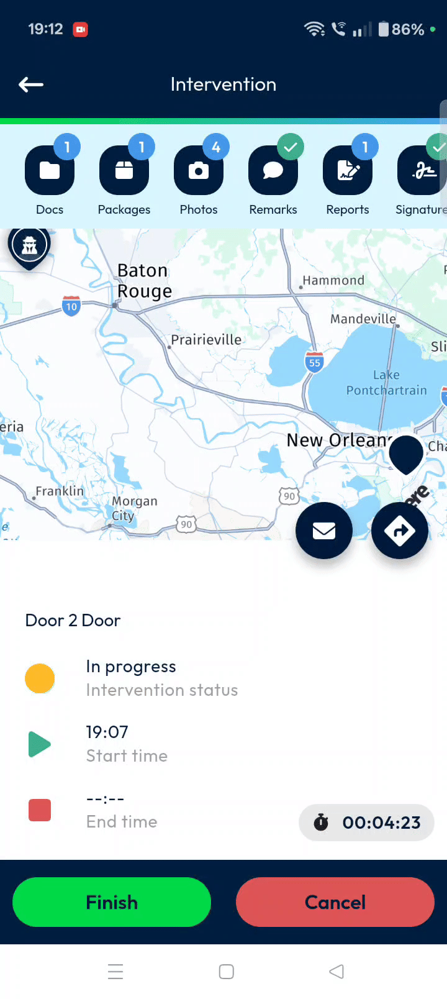

2. Um **popup de confirmação** aparecerá.

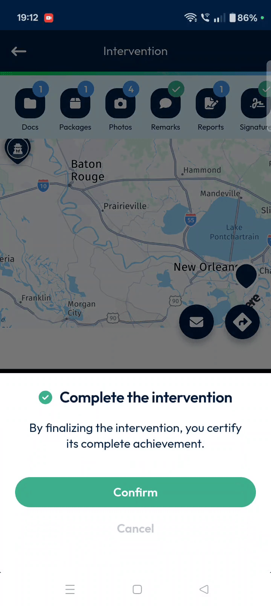

3. Uma vez que você toque em **confirmar**, o status será alterado para concluído

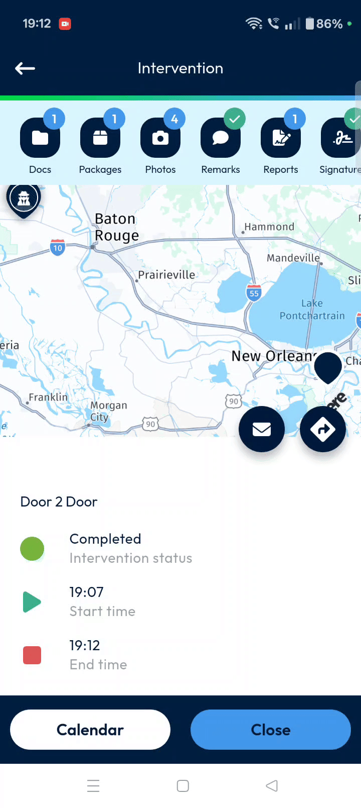

### 4. Dicas de Produtividade

* **Mantenha-se Informado com Selos**: Fique de olho nos **pequenos selos azuis** em cada ícone. Eles informam rapidamente quantos itens (documentos, fotos, pacotes) você adicionou a cada seção, ajudando você a acompanhar seu progresso de relance.
* **Use o Acesso Rápido para Comunicação**: Não se esqueça do **ícone de email** para comunicação rápida. Isso pode economizar tempo quando você precisar enviar uma atualização rápida ou contatar alguém diretamente do local da intervenção.
* **Navegue com Eficiência**: O **botão de navegação** é seu melhor amigo para chegar ao seu próximo local. Ele se integra ao seu aplicativo de mapas preferido, garantindo que você sempre tenha a rota mais eficiente.
* **Registros Detalhados são Essenciais**: Faça bom uso da **seção de Observações** e do **caixa de comentários** dentro dos detalhes do pacote. Notas detalhadas fornecem contexto valioso para sua equipe e ajudam a resolver quaisquer dúvidas futuras.
* **Verifique a Configuração do Back Office**: Lembre-se de que os campos do relatório são baseados nas **configurações do back office do TourSolver**. Se você encontrar campos inesperados ou precisar de tipos de relatório específicos, é uma boa ideia verificar com sua equipe de back office.

Seguindo este guia, você poderá gerenciar e concluir intervenções passo a passo no aplicativo TourSolver Mobile com confiança, tornando seu trabalho mais eficiente e preciso!
