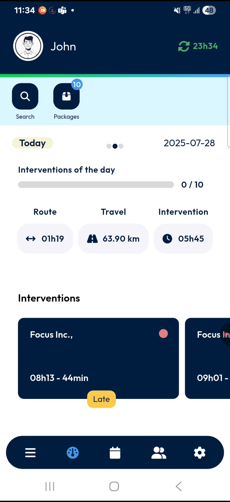
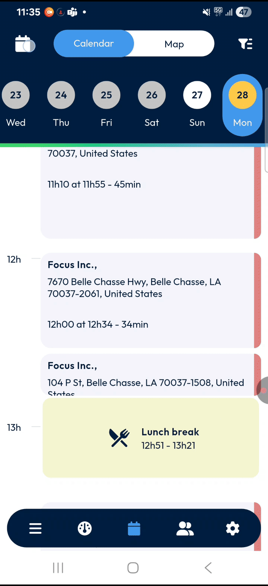
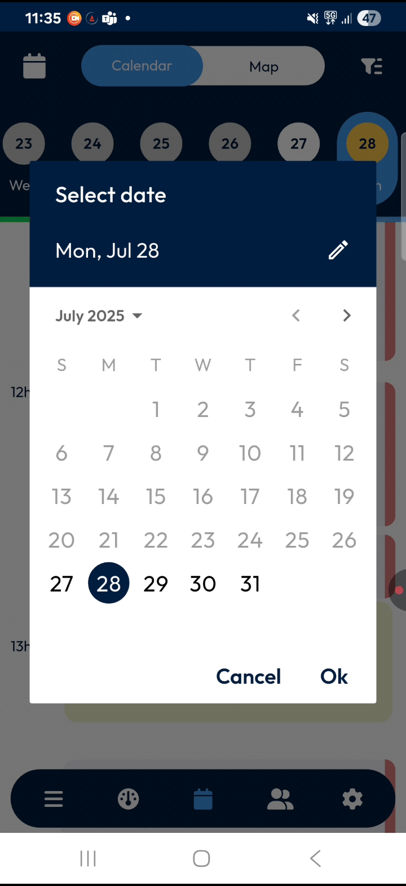
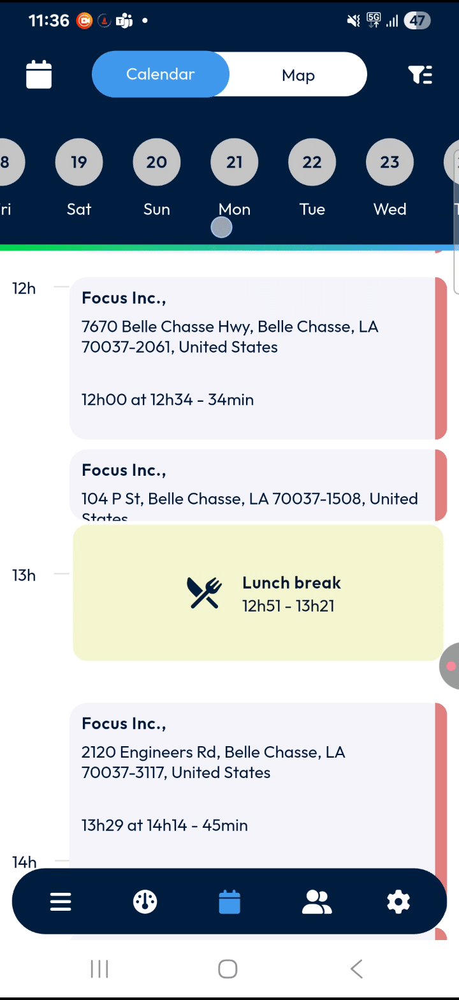
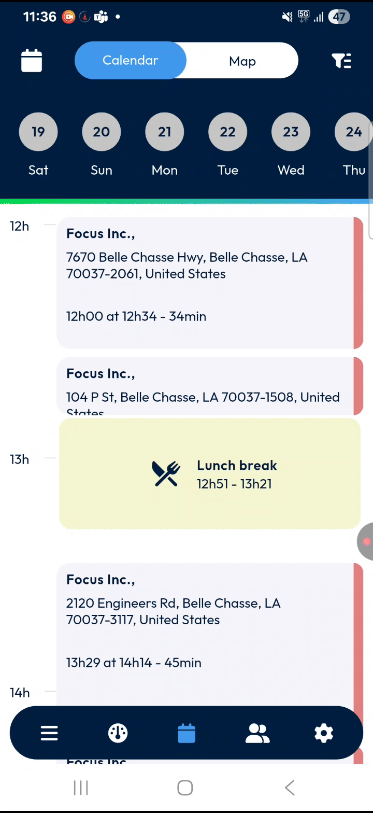
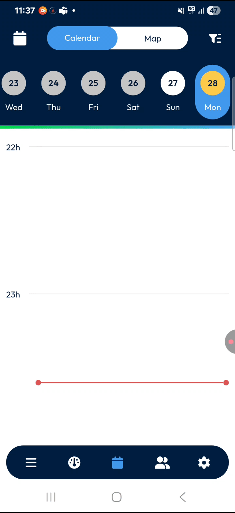
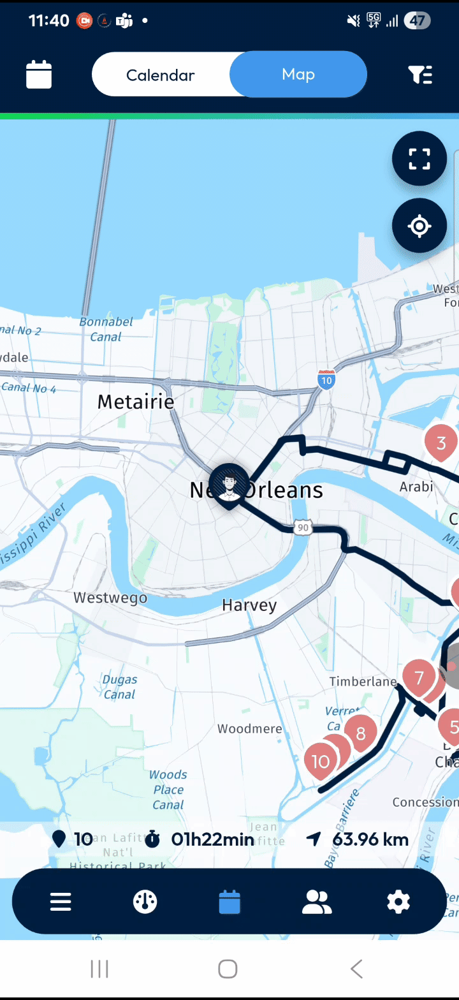
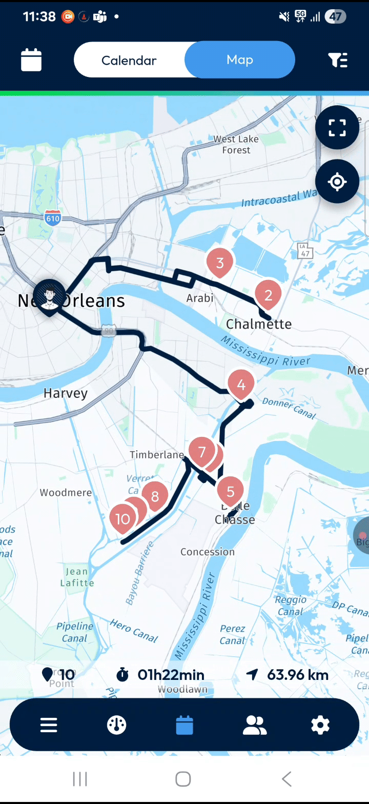

# Calendário

### 1. Introdução&#x20;

A tela do calendário é seu hub central para visualizar e gerenciar todas as suas atividades planejadas, seja para hoje ou para o futuro.

* **Requisitos do Sistema e Instalação/Configuração:** As fontes fornecidas não especificam requisitos de sistema ou etapas detalhadas de instalação/configuração para o aplicativo TourSolver Mobile. Consulte o departamento de TI da sua organização ou a página do aplicativo na loja para obter essas informações.
* **Configuração Inicial: Abrindo o Calendário** Sua jornada começa a partir do painel principal do aplicativo.
  1. Procure os botões de ação principais na **parte inferior** da tela do seu aplicativo.
  2. **Toque** no **botão do calendário**.

### 2. Explicação de Recursos e Benefícios

O calendário do TourSolver Mobile oferece recursos poderosos para mantê-lo organizado e eficiente.

* **Visão Diária (Padrão):**
  * **Benefício:** Fornece uma visão imediata da sua programação do dia atual, incluindo intervenções de clientes e eventos como almoço ou briefings.
  * **Detalhes:** Exibe as intervenções como **cartões**. Uma linha vermelha horizontal mostra a linha do tempo atual, ajudando você a ver onde está no seu dia.
* **Seleção de Data:**
  * **Benefício:** Permite visualizar facilmente as intervenções para qualquer data específica, passada (se ativada) ou futura.
  * **Detalhes:** Acessado através do **ícone do calendário** no canto superior esquerdo da tela do calendário.
* **Visão do Calendário (Cartões):**
  * **Benefício:** Apresenta uma visão clara, semelhante a uma lista, de todas as intervenções para a data selecionada, detalhando informações do cliente e horários.
  * **Detalhes:** Cada intervenção é exibida como um **cartão**, mostrando o nome do cliente, endereço, horários de início/fim e duração. Um pequeno círculo colorido à direita indica o status atual da intervenção. Eventos como "pausa para almoço", "briefing", "carregamento" e "descarregamento" também estão listados.
* **Visão do Mapa:**
  * **Benefício:** Oferece uma visão visual da sua rota diária e da localização de cada intervenção, ajudando a entender seu plano de deslocamento.
  * **Detalhes:** Mostra seu local de partida e todas as intervenções do dia, numeradas em sequência. Um resumo da rota exibe o número de intervenções, duração total e distância a percorrer. Você também pode ver os cartões de intervenção ao lado do mapa no modo de tela cheia.
* **Filtros e Opções de Exibição:**
  * **Benefício:** Personalize como você visualiza sua programação, permitindo alternar entre visualizações por dia, semana ou lista, e acessar ações importantes.
  * **Detalhes:** Acessado através do **botão de filtro** no canto superior direito da tela.
* **Legenda de Cores do Status da Intervenção:**
  * **Benefício:** Entenda rapidamente o status de cada intervenção de relance com base na sua cor.
  * **Detalhes:** A legenda de cores é acessível tocando o **botão de filtro**.
    * **Vermelho:** Status Aguardando.
    * **Vermelho Claro:** Status Aceito (isso também é indicado se um cartão disser "sua próxima visita" como sua próxima ação).
    * **Amarelo:** Em progresso.
    * **Verde:** Concluído.
    * **Roxo Escuro:** Recusado.
    * **Roxo Claro:** Abandonado.

***

### 3. Instruções Passo a Passo

Veja como realizar as principais ações dentro do Calendário do TourSolver Mobile.

**3.1. Alterando a Data de Visualização** Para visualizar sua programação em um dia diferente:

1. Na tela do calendário, toque o **ícone do calendário** no **canto superior esquerdo**.

2. O mês atual será exibido com a data de hoje destacada.
3. Você tem várias opções para escolher outra data:

4\. Depois de escolher a data, toque **OK** para confirmar sua seleção ou **Cancelar** para fechar o pop-up sem alterar a data.

**3.2. Alternando entre as Visões Calendário e Mapa** Você pode escolher como deseja visualizar suas intervenções:

1. No topo, ao centro da tela, ao lado do ícone do calendário, você verá dois ícones de visualização.
2. **Toque** o ícone respectivo para alternar:

**3.3. Usando Filtros e Opções de Exibição** Para refinar sua visualização ou acessar ações:

1. Toque o **botão de filtro** no **no canto superior direito** da tela.

2. A partir deste menu, você pode alternar entre Semana, Dia e Lista

**3.4. Visualizando Detalhes da Intervenção na Visualização em Cartão**

1. Depois que seus filtros estiverem definidos, role para baixo para ver todas as suas intervenções para a data selecionada.
2. Cada intervenção aparece como um **cartão**.
3. Em cada cartão, você verá:
   * O **nome** do cliente **e**.
   * endereço **Horários de início e fim da** do cliente **Intervenção**.
   * duração **Um pequeno** círculo colorido
     * indicando o status atual (consulte a Legenda de Cores no menu de filtros). **💡** Dica:**Se um cartão disser "**&#x53;ua próxima visita
4. ," isso significa sua próxima ação imediata. **Para ver mais detalhes e iniciar uma tarefa,** toque
   * em um cartão de intervenção.

**\[Captura de tela: cartão de intervenção exemplo com detalhes destacados]** 3.5. Explorando a Visualização do Mapa

1. Toque o **Para uma visão visual da sua rota:** ícone de visualização do mapa
2. no topo, ao centro da tela.
   * O mapa exibirá: **Seu**.
   * local de partida **Cada intervenção do dia,**.
   * numeradas em ordem **Um** resumo da rota
   * O mapa exibirá: **incluindo o número de intervenções, duração total e distância a percorrer.** rota desenhada
3. **no mapa.**

**Visualização do Mapa em Tela Cheia:** 3.6. Retornando à Tela Principal do Calendário **Você pode sempre retornar à tela principal do calendário tocando a** no **canto superior esquerdo**.

***

### seta de voltar

4\. Dicas de Produtividade

* **💡 A tela do calendário foi projetada para ajudá-lo a ver e gerenciar rapidamente as intervenções para qualquer data, hoje ou no futuro.** Mantenha-se Atualizado: **Use regularmente a** "Atualizar minha agenda" **função (encontrada em**botão de filtro > Ações
* **) para garantir que seu calendário reflita as últimas mudanças feitas pelo seu planejador. Isso é crucial para um agendamento preciso.** Pesquisa Rápida: **Se precisar encontrar uma intervenção específica, não role sem fim! Use a** "Pesquisar por uma intervenção" **função (encontrada em**ferramenta (também em
* **) para localizá-la rapidamente digitando um nome, número, data ou endereço.** Planejamento Visual: **Aproveite a** Visão do Mapa
* **para entender sua rota diária e a distribuição geográfica de suas intervenções. Isso pode ajudá-lo a antecipar tempos de deslocamento e otimizar sua sequência de visitas.** Status de Relance: **Familiarize-se com a** legenda de cores
