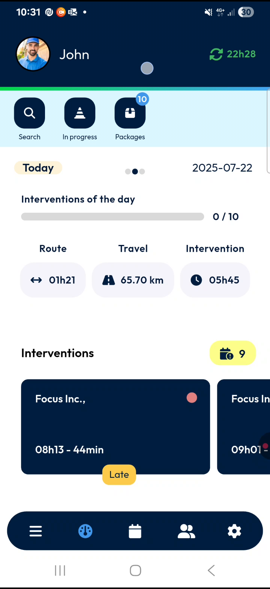
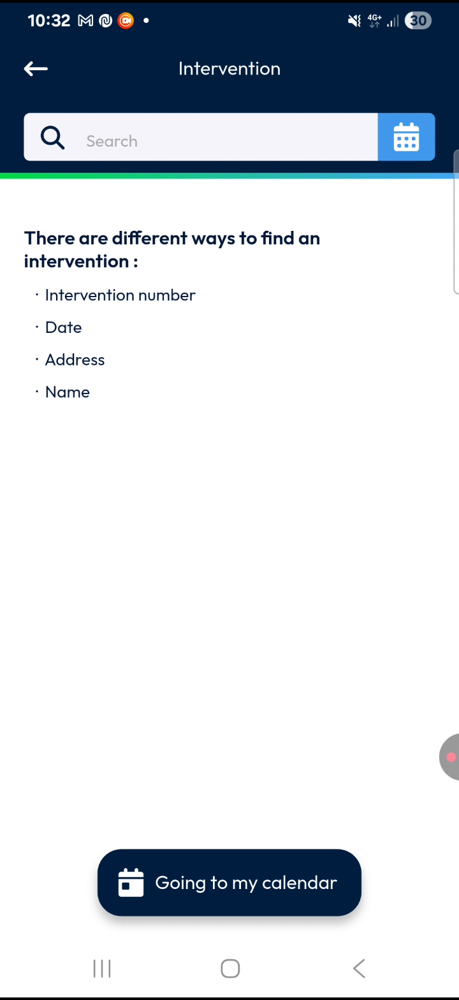
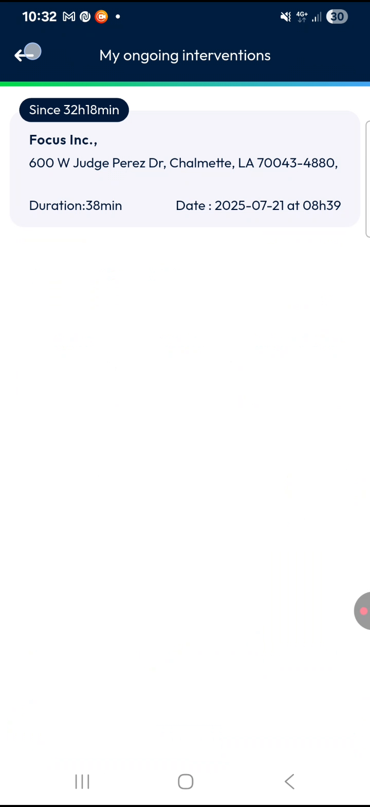
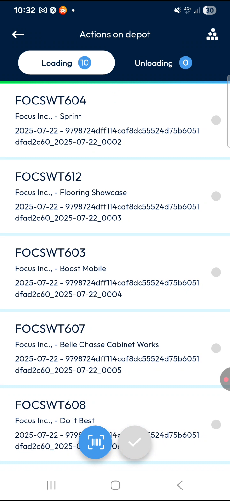
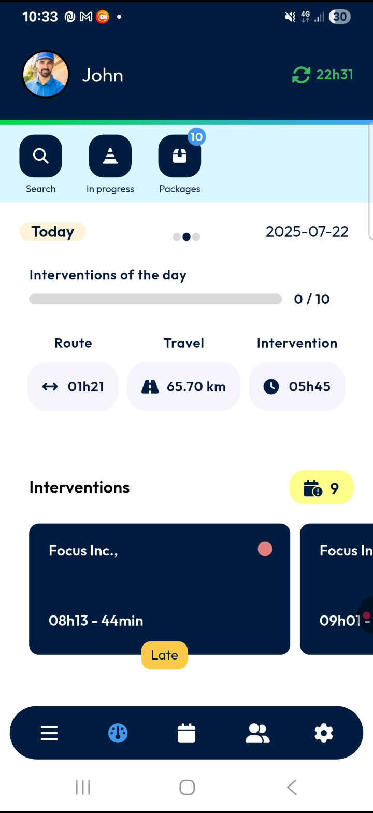
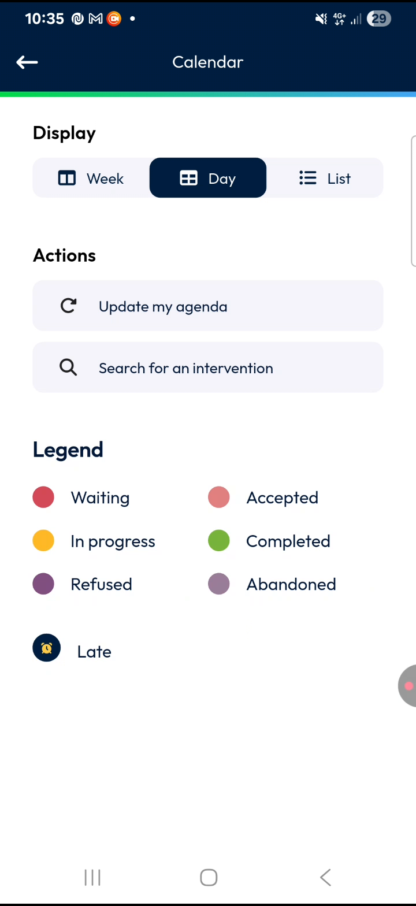
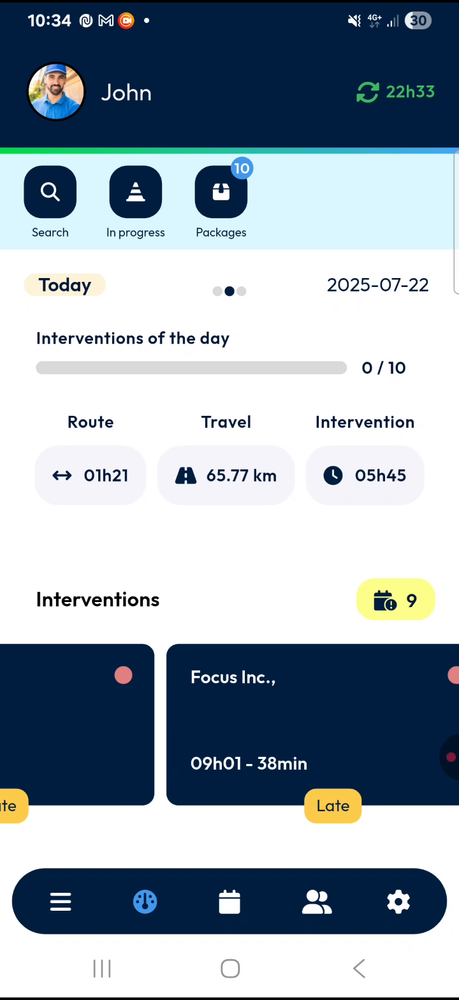

# Painel

### 1. Começando

Após o login bem‑sucedido, você verá imediatamente seu(a) **Painel** de controle. Esta tela foi projetada para lhe dar uma visão rápida das atividades do seu dia.

* **Visualização Inicial Após o Login**: Quando você fizer login pela primeira vez, seu painel exibirá sua agenda e progresso. Por exemplo, o **Barra de progresso** pode mostrar "0 de 10", o que significa que você tem 10 intervenções agendadas para hoje e nenhuma foi concluída ainda. Esta barra será atualizada automaticamente à medida que você concluir tarefas ao longo do dia.

### 2. Explicações de Recursos com Benefícios

O Painel do TourSolver Mobile está repleto de recursos úteis projetados para ajudá‑lo a gerenciar seu dia de forma eficaz.

* **Seção Superior: Seu Perfil e Estado dos Dados**
  * **Avatar e Nome**: No **canto superior esquerdo**, você verá sua **foto de perfil (avatar)** e seu **nome** nome exibido ao lado dela.
    * **Benefício**: Isso confirma que você está conectado e ajuda a personalizar sua experiência.

* **Hora da Sincronização**: No **canto superior direito**, você pode ver a **última vez que o aplicativo sincronizou com sucesso com o back office**.
  * **Benefício**: Isso informa o quão atualizados estão seus dados, garantindo que você esteja trabalhando com as informações mais recentes.

* **Botões de Ação Rápida: Suas Ferramentas Diárias** Logo abaixo da seção superior, esses botões fornecem acesso rápido a funções importantes:
  * **Pesquisar**: Este botão permite que você **encontre rapidamente qualquer intervenção** digitando um nome de cliente, um número, uma data ou um endereço.
    * **Benefício**: Economiza tempo ajudando você a localizar tarefas específicas sem ter que percorrer toda a sua agenda.

* **Intervenções em Andamento**: Este botão exibe uma **lista de suas intervenções que estão atualmente em andamento**.
  * **Benefício**: Ajuda você a se concentrar nas tarefas em que está trabalhando ativamente.
    * 💡 **Sugestão**: Este botão aparece apenas se você tiver intervenções atualmente marcadas como "em andamento".

* **Carregar Pacotes**: Este botão é usado para **carregar todos os pacotes de entrega em seu caminhão** antes de iniciar sua rota do dia.
  * **Benefício**: Garante que você tenha todos os itens necessários prontos antes de começar suas tarefas diárias.

* **Carrossel de Agenda: Sua Programação de Relance** Abaixo dos botões de ação rápida, você encontrará um **carrossel de agenda**.
  * Isto mostra sua **programação para hoje**.
  * Você pode **deslize para a direita** para ver a agenda de ontem ou **deslize para a esquerda** para ver a agenda de amanhã.
  * O **dia** (por exemplo, "hoje", "ontem" ou "amanhã") é exibido no **lado esquerdo** do carrossel.
  * O **data atual** para o dia selecionado é mostrada no **lado direito**.
  * **Benefício**: Fornece uma visão clara e flexível da sua programação para os dias atual, passados ou futuros.

* **Barra de Progresso: Acompanhe Sua Conclusão Diária** Abaixo do carrossel de agenda, a **barra de progresso** representa visualmente **quantas intervenções você concluiu hoje**.
  * À medida que você conclui intervenções, esta barra é atualizada automaticamente em tempo real.
  * **Benefício**: Oferece uma atualização visual imediata sobre seu progresso, ajudando‑o a manter a motivação e o foco.

* **Resumo da Rota: Visão Geral da Sua Carga de Trabalho** Logo abaixo da barra de progresso, o **Um** fornece três informações principais para o seu dia:
  * **Rota**: O **distância total** que você percorrerá hoje.
  * **Deslocamento**: O **quilômetros totais planejados** para o dia.
  * **endereço**: O **duração geral das intervenções** planejadas para o dia.
  * **Benefício**: Dá‑lhe uma visão rápida e essencial da sua carga de trabalho diária, ajudando‑o a entender o alcance das suas tarefas.

* **Seção de Intervenção: Detalhes das Suas Tarefas** Ao rolar para baixo, você entrará na **seção de intervenção** onde todas as tarefas do seu dia são exibidas como **cartões individuais**.
  * Você pode **deslize estes cartões da direita para a esquerda** para percorrer todas as suas intervenções agendadas.
  * À direita do rótulo "Intervenção", você verá uma contagem de **quantas intervenções estão atrasadas hoje**. Por exemplo, pode mostrar "nove intervenções estão atrasadas hoje".
  * Cada **cartão de intervenção** exibe detalhes importantes:
    * O **nome do cliente**.
    * O **horário agendado** para essa intervenção.
    * O **duração estimada** do andamento da intervenção.
  * **Círculo Colorido**: Um pequeno **Um pequeno** no canto superior direito de cada cartão representa o **estado atual da intervenção** (por exemplo, concluída, aceita).
    * **Benefício**: Fornece uma indicação visual rápida do status da tarefa.
    * 💡 **Sugestão**: Você pode encontrar a **legenda para essas cores** na **no menu do calendário** em " **opção de filtro**.

* **Bandeira de Atraso**: Se uma tarefa estiver atrasada, você verá uma pequena **bandeira retangular amarela "atrasada"** na parte inferior central do cartão.
  * **Benefício**: Destaca imediatamente as tarefas vencidas, ajudando‑o a priorizar.

* **Benefício**: Oferece uma visão abrangente e detalhada de cada tarefa, facilitando ver todas as informações necessárias rapidamente.

* **Botões Principais de Navegação: Movendo‑se pelo Aplicativo** Na parte inferior do painel, você encontrará os **botões do menu principal**. Eles permitem que você alterne facilmente entre as diferentes telas do aplicativo, incluindo:
  * **Menu**
  * **Painel**
  * **Calendário**
  * **Leads e Clientes**
  * **Configurações**
  * **Benefício**: Fornece navegação contínua por todo o aplicativo TourSolver Mobile.

### 3. Instruções Passo a Passo

Veja como interagir com alguns recursos principais do seu painel:

* **Revisando Sua Agenda para Dias Diferentes**:
  1. Localize o **Carrossel de agenda** abaixo dos botões de ação rápida.
  2. Para ver **a programação de ontem**, **deslize o carrossel para a direita**.
  3. Para ver **a programação de amanhã**, **deslize o carrossel para a esquerda**.
  4. O dia e a data exibidos no carrossel serão atualizados para refletir sua seleção.

* **Navegando Pelas Suas Intervenções**:
  1. Role para baixo até a **seção de Intervenção**.
  2. Você verá suas intervenções agendadas exibidas como cartões individuais.
  3. Para ver todas as suas intervenções do dia, **deslize estes cartões da direita para a esquerda**.

* **Encontrar Rapidamente uma Intervenção Específica**:
  1. Localize o **Botão de pesquisa** logo abaixo das informações do seu perfil.
  2. **Toque no botão Pesquisar**.
  3. **Digite o nome, número, data ou endereço** da intervenção que você está procurando.
  4. O aplicativo exibirá resultados correspondentes, ajudando‑o a ir rapidamente para a tarefa desejada.

### 4. Dicas de Produtividade

* 💡 **Mantenha‑se Sincronizado**: Verifique regularmente a **hora da Sincronização** no canto superior direito. Uma sincronização recente significa que seus dados estão atualizados, o que é crucial para gerenciar suas tarefas de forma eficaz.
* 💡 **Planeje com Antecedência ou Revise o Passado**: Use o **Carrossel de agenda** para deslizar rapidamente entre hoje, ontem e amanhã. Isso ajuda a planejar seu próximo dia ou revisar tarefas concluídas.
* 💡 **Priorize Tarefas Atrasadas**: Fique sempre atento à **contagem de "atrasadas"** na seção de intervenção e à **bandeira amarela "atrasada"** nos cartões de intervenção individuais. Abordá‑las prontamente pode ajudar a manter sua programação em dia.
* 💡 **Entenda o Status de Relance**: Familiarize‑se com os **círculos coloridos** nos cartões de intervenção e seus significados consultando a **legenda no menu Calendário na opção de filtro**. Isso permite uma avaliação visual rápida do status de cada tarefa.
* 💡 **Aproveite as Ações Rápidas**: Faça uso dos **Pesquisar**, **botões de Máquinas em Andamento**, e **Carregar Pacotes** Eles são projetados para acesso rápido a funções essenciais e podem aumentar significativamente sua eficiência.

O painel é sua ferramenta definitiva para gerenciar suas tarefas diárias com confiança e eficiência. Se você precisar de informações mais detalhadas sobre qualquer seção específica, consulte outros guias dedicados.
