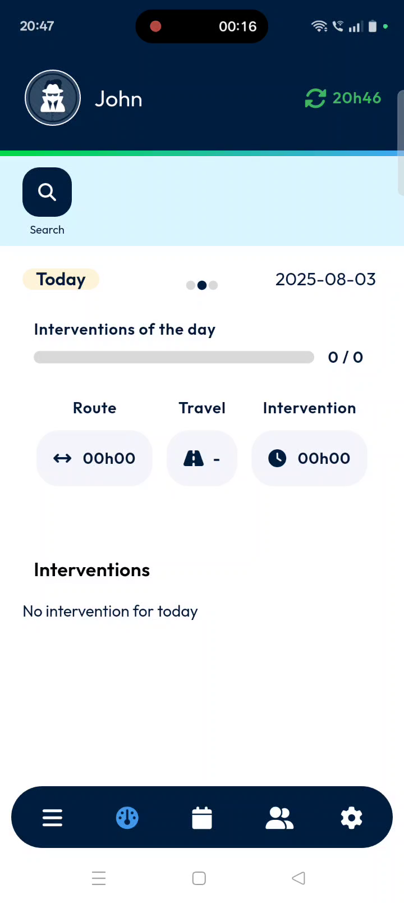
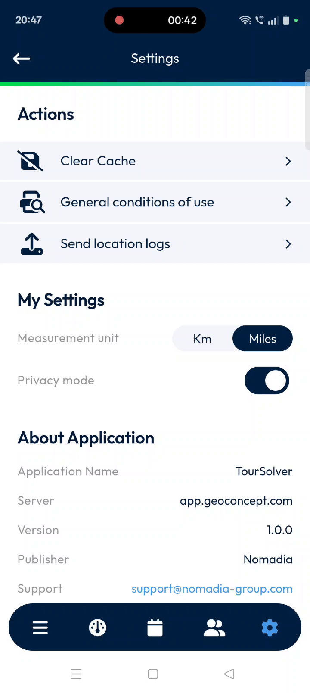
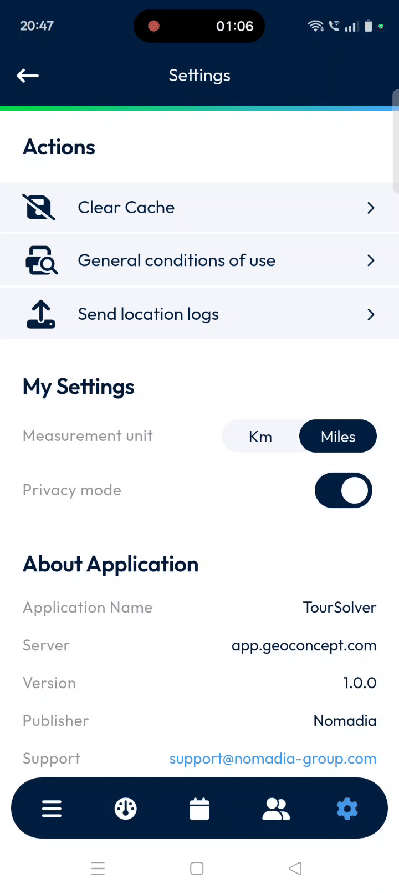
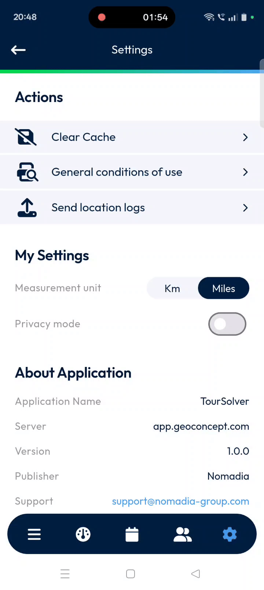

# Configurações

### 1. Introdução

Embora as fontes fornecidas não especifiquem os requisitos exatos do sistema para o TourSolver Mobile App ou seus passos iniciais de instalação, esta seção irá guiá-lo sobre como acessar e realizar as configurações iniciais essenciais nas definições do aplicativo.

**1. Acedendo ao Ecrã de Definições** Para aceder às definições:

1. **Inicie o TourSolver Mobile App**.
2. Localize o **ícone de engrenagem** na barra de navegação inferior.
3. Toque o **ícone de engrenagem**.

4. Agora estará no **ecrã de Definições**. Aqui encontrará três secções principais: **Ações**, **As Minhas Definições**, e **Sobre a Aplicação**.
   * _Imagine uma captura de ecrã aqui mostrando o ecrã principal de Definições com as três secções claramente rotuladas._

**2. Configuração Inicial (Primeiros Passos Importantes)**

* **Defina a Sua Unidade de Medida Preferida**:
  1. No ecrã de Definições, navegue até à **As Minhas Definições** secção.
  2. Toque na opção "unidade de medida".
  3. Escolha a sua unidade preferida selecionando **Quilómetro** ou **Milhas** com base na sua região ou preferência.

* **Ativar o Modo de Privacidade para Controlo de Dados**:
  1. No ecrã de Definições, também em **As Minhas Definições**, encontre a opção "Ativar modo de privacidade".
  2. **Alterne** esta opção para **limitar a recolha de dados do aplicativo**.
  3. indicando o status atual (consulte a Legenda de Cores no menu de filtros). **Sugestão**: Ativar o modo de privacidade é uma ótima forma de garantir que suas informações pessoais sejam tratadas de acordo com **os padrões do RGPD**, dando-lhe controlo total sobre como os seus dados são partilhados.

***

### 2. Compreendendo as Funcionalidades do Seu Aplicativo (Secções de Definições)

O separador Definições organiza funcionalidades valiosas em três secções fáceis de entender:

* **Ações**: Esta secção oferece opções para gerir o desempenho do aplicativo e facilitar o suporte.
  * **Limpar Cache**: Esta opção ajuda o seu aplicativo a funcionar de forma suave removendo ficheiros temporários.
    * **Benefício**: Optimiza o desempenho e atualiza conteúdo desatualizado, garantindo que vê sempre as informações mais recentes.
  * **Condições Gerais de Utilização**: Aqui, pode aceder e ler os avisos legais oficiais, termos e definições que se aplicam em todo o aplicativo.
    * **Benefício**: Mantenha-se informado sobre os seus direitos e responsabilidades ao utilizar o aplicativo.
  * **Enviar Registos de Localização**: Esta funcionalidade permite enviar com segurança o seu histórico de localização diretamente para a equipa de suporte.
    * **Benefício**: Essencial para resolução de problemas ou fins de diagnóstico se encontrar qualquer problema que necessite de assistência técnica.
* **As Minhas Definições**: Esta secção permite personalizar a sua experiência no aplicativo.
  * **Unidade de Medida**: Escolha a sua unidade preferida para medições de distância.
    * **Benefício**: Personalize o aplicativo para mostrar distâncias em **quilómetros** ou **milhas**, tornando-o mais conveniente e familiar para si.
  * **Modo de Privacidade**: Controle como os seus dados pessoais são recolhidos pelo aplicativo.
    * **Benefício**: Ao ativar isto, alinha o processamento de dados do aplicativo com **os padrões do RGPD**, garantindo que tem controlo total sobre as suas informações pessoais e como são partilhadas.
* **Sobre a Aplicação**: Esta secção fornece informações técnicas essenciais sobre o TourSolver Mobile App.
  * **Nome da Aplicação**: A aplicação chama-se **TourSolver**.
  * **Servidor**: Sincroniza dados usando o servidor `apps.concept.com`.
  * **Versão**: Exibe a versão atual instalada, por exemplo, `1.0.0`.
  * **Editor**: A aplicação é desenvolvida e publicada por **Nomadia**, um líder reconhecido em soluções de mobilidade inteligente.
  * **Suporte**: Fornece o endereço de e-mail de suporte: `support@nomadiagroup.com` para qualquer assistência.
  * **Website**: Fornece o endereço do site oficial: `www.nomadiagroup.com` para mais informações.
    * **Benefício**: Encontre rapidamente detalhes importantes sobre o aplicativo, incluindo informações de contacto para suporte, o que é útil para resolução de problemas ou esclarecimentos.

***

### 3. Tarefas Comuns nas Definições

Aqui estão instruções passo a passo para ações comuns que poderá querer realizar no separador Definições:

* **Como Limpar a Cache do Aplicativo**:
  1. No ecrã de Definições, toque em **Limpar Cache** em " **Ações** secção.
  2. Um pop-up de confirmação aparecerá, perguntando "Tem a certeza de que deseja limpar a cache da sua aplicação?"

* **Como Ler as Condições Gerais de Utilização**:
  1. No ecrã de Definições, toque em **Condições Gerais de Utilização** em " **Ações** secção.
  2. Será levado a um novo ecrã onde poderá ler os avisos legais completos, termos e definições.

* **Como Enviar Registos de Localização para o Suporte**:
  1. No ecrã de Definições, toque em **Enviar Registos de Localização** em " **Ações** secção.
  2. Após tocar, uma mensagem de confirmação aparecerá, indicando que "os registos foram enviados com sucesso."

* **Como Alterar a Sua Unidade de Medida**:
  1. No ecrã de Definições, localize o **As Minhas Definições** secção.
  2. Toque na opção para **unidade de medida**.
  3. Escolha a sua unidade preferida selecionando **Quilómetro** ou **Milhas** com base na sua região ou preferência.

* **Como Ativar o Modo de Privacidade**:
  1. No ecrã de Definições, localize o **As Minhas Definições** secção.
  2. Encontre a opção "Ativar modo de privacidade."
  3. **Alterne** o interruptor ao lado desta opção para o colocar **ligado** (para limitar a recolha de dados) ou **desligado**.

### seta de voltar&#x20;

* **Limpeza Regular da Cache**: Torne um hábito **Limpar Cache** periodicamente. Isto mantém o seu aplicativo rápido e responsivo, prevenindo lentidões causadas pelo acumular de ficheiros temporários.
* **Controlo de Dados**: Aproveite o **Modo de Privacidade**. Se a privacidade de dados for uma preocupação, ativar esta funcionalidade dá-lhe maior controlo sobre como a sua informação é tratada, alinhando-se com os padrões internacionais de privacidade.
* **Acesso Rápido ao Suporte**: Se encontrar algum problema técnico, lembre-se que a funcionalidade **Enviar Registos de Localização** pode ser uma forma rápida de fornecer informação diagnóstica essencial à equipa de suporte. Também pode encontrar o **endereço de e-mail de suporte** do cliente **site** em "Sobre a Aplicação" para assistência direta.
* **Mantenha-se Informado**: Reveja periodicamente as **Condições Gerais de Utilização** para se manter atualizado sobre quaisquer avisos legais ou termos que regem o seu uso da aplicação.
